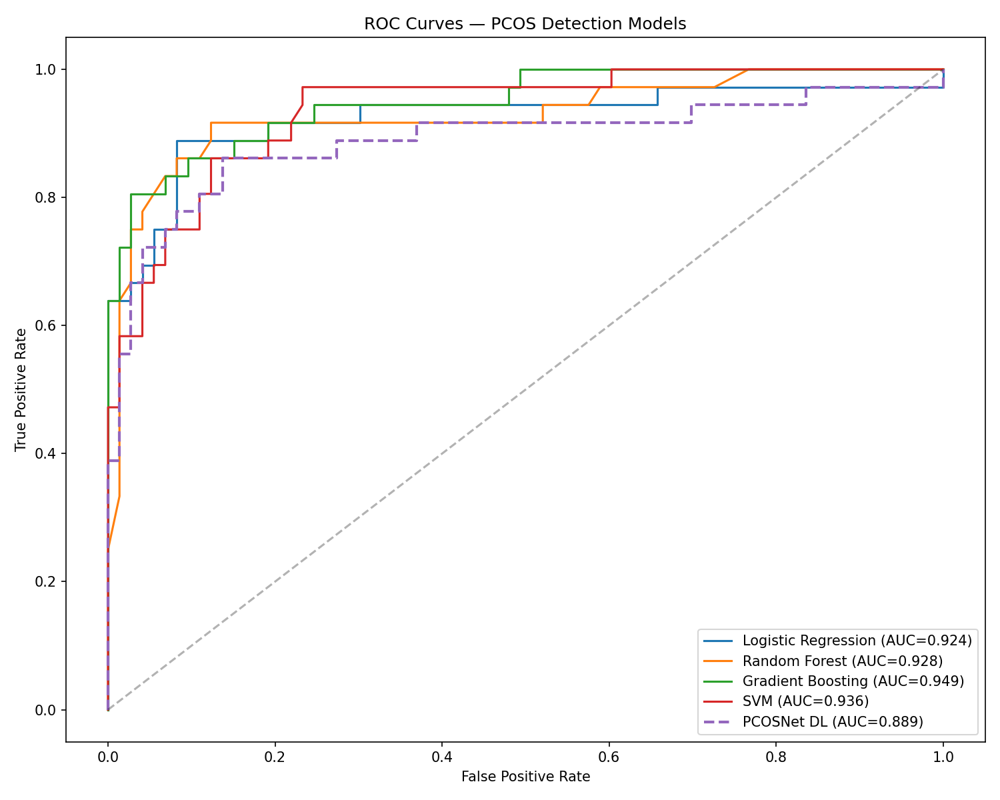
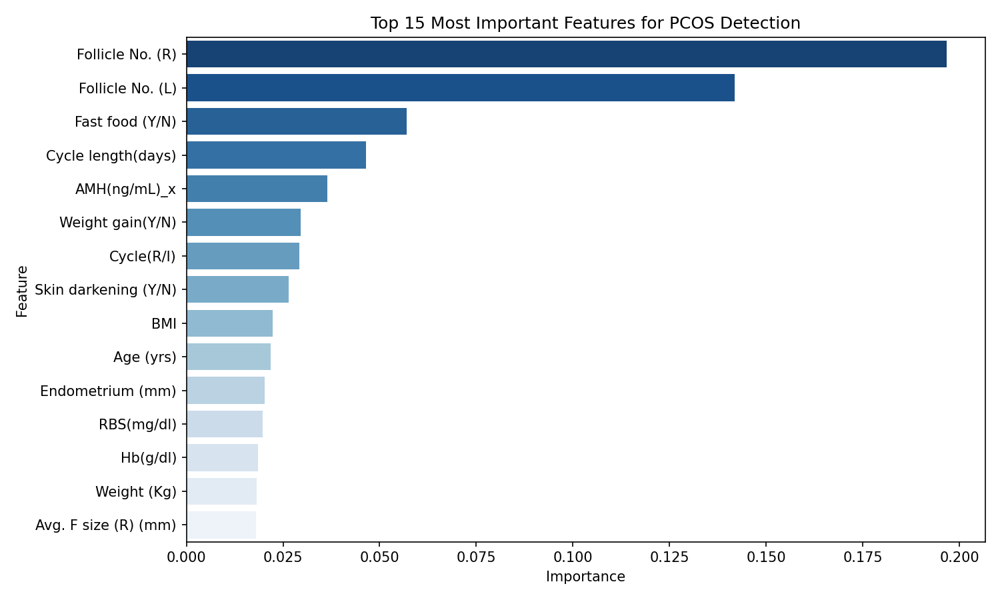
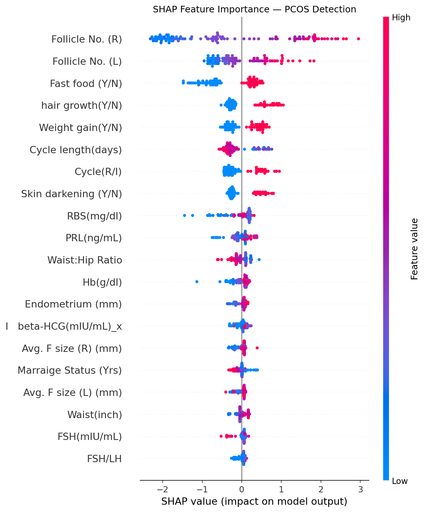
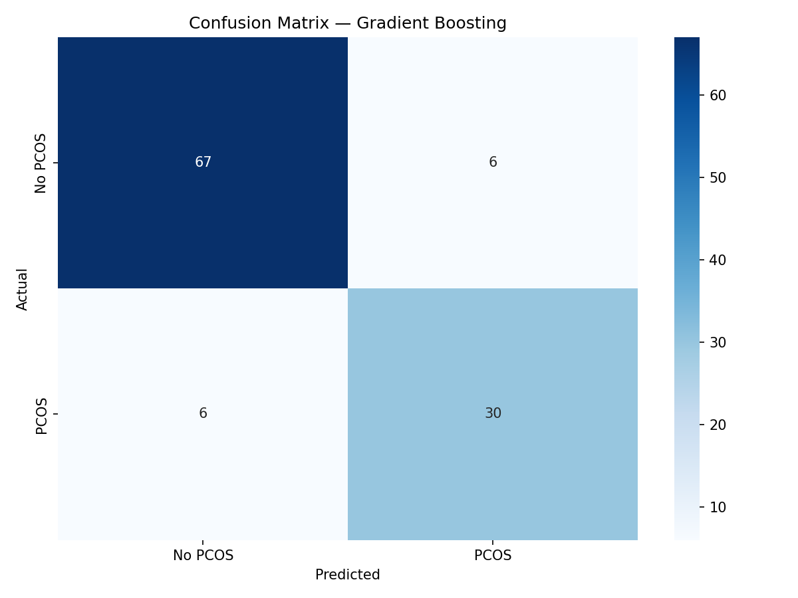

# PCOS Detection Using Machine Learning & Deep Learning

A clinical machine learning project for detecting Polycystic Ovary Syndrome (PCOS) from patient data using multiple ML models, a custom deep learning architecture, and SHAP explainability.

## Overview

Polycystic Ovary Syndrome (PCOS) affects approximately 1 in 5 women globally, with higher prevalence in South Asian populations. Early and accurate detection is critical for timely treatment. This project builds and compares multiple machine learning models for PCOS detection from clinical data, with a focus on model interpretability for clinical use.

## Results

| Model | Accuracy | Precision | Recall | F1 | AUC-ROC |
|---|---|---|---|---|---|
| Logistic Regression | 86.24% | 74.42% | 88.89% | 81.01% | 0.9239 |
| Random Forest | 88.99% | 83.33% | 83.33% | 83.33% | 0.9279 |
| **Gradient Boosting** | **88.99%** | **83.33%** | **83.33%** | **83.33%** | **0.9486** |
| SVM | 85.32% | 77.78% | 77.78% | 77.78% | 0.9359 |
| PCOSNet (Deep Learning) | 86.24% | 81.82% | 75.00% | 78.26% | 0.8893 |

**Best model: Gradient Boosting — AUC-ROC 0.9486**

## Dataset

- **Source:** [PCOS Dataset — Kaggle](https://www.kaggle.com/datasets/prasoonkottarathil/polycystic-ovary-syndrome-pcos)
- **Patients:** 541
- **Features:** 41 clinical features including hormone levels, physical measurements, ultrasound findings, and lifestyle factors
- **Target:** PCOS diagnosis (binary — Yes/No)
- **Class distribution:** 364 No PCOS, 177 PCOS

## Key Features by Importance

1. Follicle Count (Right Ovary) — 19.7%
2. Follicle Count (Left Ovary) — 14.2%
3. Fast Food Consumption — 5.7%
4. Cycle Length — 4.6%
5. AMH Hormone Level — 3.6%

Follicle count dominates — consistent with clinical PCOS diagnosis criteria.

## Methodology

### Preprocessing
- Merged two clinical datasets on Patient File No.
- Handled dirty values and type inconsistencies
- Filled missing values with median/mode imputation
- Applied SMOTE oversampling to handle class imbalance (364 vs 177)
- StandardScaler normalization

### Models
- **Classical ML:** Logistic Regression, Random Forest, Gradient Boosting, SVM
- **Deep Learning:** Custom PCOSNet — 5-layer neural network with BatchNorm, Dropout, early stopping
- **Explainability:** SHAP (SHapley Additive exPlanations) for feature attribution

### Training
- 80/20 train-test split with stratification
- SMOTE applied only on training data to prevent data leakage
- Early stopping with patience=20 for deep learning model
- Learning rate scheduling with ReduceLROnPlateau

## Visualizations

| | |
|---|---|
|  |  |
|  |  |

## Key Findings

- Gradient Boosting achieves the highest AUC-ROC (0.9486), making it the most reliable model for clinical screening
- Deep learning underperforms classical ML on this dataset size (541 patients) — a common finding in small clinical datasets
- SHAP analysis confirms the model relies on clinically meaningful features (follicle count, AMH) rather than spurious correlations
- High-confidence PCOS predictions (>85%) show follicle counts of 12–15 per ovary, consistent with clinical diagnostic criteria

## Tech Stack

- **Python 3.10**
- **PyTorch** — deep learning model
- **scikit-learn** — classical ML models
- **imbalanced-learn** — SMOTE oversampling
- **SHAP** — model explainability
- **pandas, numpy** — data processing
- **matplotlib, seaborn** — visualization
- **Google Colab** — GPU training environment

## Installation

```bash
git clone https://github.com/SamiiN13/pcos-detection.git
cd pcos-detection
pip install -r requirements.txt
```

## Usage

Open `pcos_detection.ipynb` in Google Colab or Jupyter Notebook and run all cells in order.

## Future Work

- Collect original gynecological ultrasound data from South Asian clinical settings
- Extend to multimodal detection combining clinical data with ultrasound images
- Deploy as a clinical decision support web application
- Validate on larger, geographically diverse datasets

## Author

**Samiha** — BSc CSE, BRAC University  
[GitHub](https://github.com/SamiiN13)